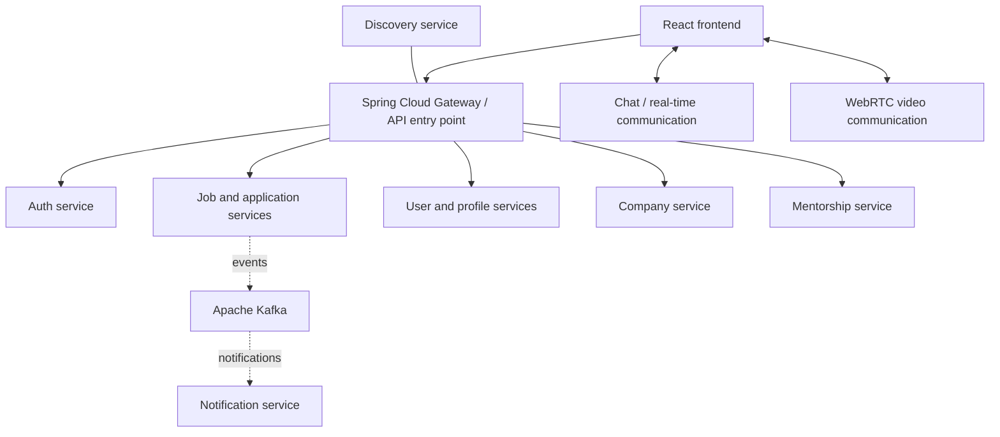

# Jobly — Career & Mentorship Platform

Jobly is a career platform project intended to connect job seekers, companies, and mentors through job discovery, application management, and real-time communication.


## Project Overview

The repository is organized into a React frontend and a backend composed of separately organized Spring services.

### Product capabilities described in the project

**For job seekers**
- Search jobs and internships by skills and interests.
- Maintain a professional profile and submit applications.
- Connect with mentors through chat and video-call features.
- Manage documents with Google Drive integration.

**For companies**
- Maintain company profiles and job postings.
- Review candidate profiles and applications.
- Manage application statuses and notifications.

## Backend Service Layout

The `Backend/` directory currently contains these service modules:

- `AuthService` — authentication-related functionality.
- `ChatService` — chat functionality.
- `CompanyService` — company profiles and job postings.
- `DiscoveryService` — service discovery.
- `EmailService` — email notifications.
- `JobApplicationService` — application processing.
- `JobProfileService` — job-seeker profiles.
- `JobService` — job listings and search.
- `MentorService` — mentorship functionality.
- `NotificationService` — notifications.
- `PaymentService` — payment integration.
- `SkillService` — skills management.
- `UserService` — user accounts.

## Architecture (high-level)



This is a conceptual view based on the repository's documented components and service names, not a deployment diagram. Verify actual routes, event flows, and service dependencies in source before relying on it operationally.

## Technology Stack

| Area | Technologies documented in this project |
|---|---|
| Frontend | React, GSAP |
| Backend | Spring Boot, Spring WebFlux, Spring Cloud Gateway, OpenFeign |
| Security | Spring Security, Keycloak, OAuth 2.0 |
| Messaging | Apache Kafka |
| Real-time | WebSocket, Server-Sent Events, WebRTC |
| Data | MySQL, distributed caching |
| Integrations | Google Drive API, Razorpay |
| Infrastructure concepts | Service discovery, API gateway, load balancing, containerization |

## Repository Structure

```text
Jobly/
├── Backend/
│   ├── AuthService/
│   ├── ChatService/
│   ├── CompanyService/
│   ├── DiscoveryService/
│   ├── EmailService/
│   ├── JobApplicationService/
│   ├── JobProfileService/
│   ├── JobService/
│   ├── MentorService/
│   ├── NotificationService/
│   ├── PaymentService/
│   ├── SkillService/
│   └── UserService/
└── Frontend/
    └── sih_frontend/
```

## Getting Started

### Prerequisites

The original project setup notes list:
- Java 17+
- Node.js 14+
- MySQL 8+
- Apache Kafka
- Keycloak
- Google Cloud credentials for Drive integration, if using that feature
- Razorpay credentials for payment integration, if using that feature

### Start backend services

1. Start and configure the required infrastructure (database, Kafka, and Keycloak).
2. Start the discovery service first:

```bash
cd Backend/DiscoveryService
./mvnw spring-boot:run
```

3. Start an individual backend service from its module directory:

```bash
cd Backend/<ServiceName>
./mvnw spring-boot:run
```

On Windows, use the Maven wrapper script `mvnw.cmd` where available.

### Start the frontend

```bash
cd Frontend/sih_frontend
npm install
npm start
```

### Configuration and security

Configure service URLs, database settings, Keycloak, Kafka, and third-party integrations using local environment/configuration files. Never commit API keys, passwords, client secrets, or production credentials. Exact environment-variable names and ports should be taken from each service's configuration.

## Notes

This README describes the repository's documented design and setup. The services and integrations may have different levels of implementation or may require configuration before the full platform runs end-to-end. Check each module's source and tests for its current status.

## Contributing

1. Create a focused branch for your change.
2. Make the change in the relevant service or frontend module.
3. Add or update tests.
4. Run the checks for the affected module.
5. Open a pull request with a concise summary and verification notes.

---

Built by Ankit Chauhan.
